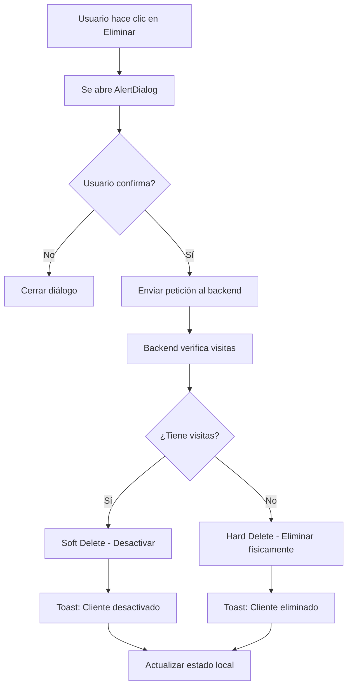

# 🚨 Implementación de Alerta de Eliminación de Clientes

## 📋 Descripción General

Se implementó un sistema de alertas informativas para el proceso de eliminación de clientes que explica claramente al usuario el comportamiento del sistema según la lógica de integridad de datos.

## 🎯 Funcionalidad Implementada

### Sistema de Eliminación Inteligente

El sistema maneja dos tipos de eliminación:

1. **Eliminación Física**: Se elimina completamente el registro
   - ✅ Cuando el cliente NO tiene visitas registradas
   - ✅ Se remueve totalmente de la base de datos

2. **Eliminación Lógica (Soft Delete)**: Se desactiva el registro
   - ✅ Cuando el cliente SÍ tiene visitas registradas
   - ✅ Se cambia el estado `activo` a `FALSE`
   - ✅ Se preservan los datos históricos

### Componentes Implementados

#### 1. AlertDialog Informativo
```typescript
// Ubicación: R-M-P/client/app/clientes/page.tsx
<AlertDialog open={deleteDialogOpen} onOpenChange={setDeleteDialogOpen}>
  <AlertDialogContent>
    <AlertDialogHeader>
      <AlertDialogTitle>Eliminar Cliente</AlertDialogTitle>
      <AlertDialogDescription>
        // Información detallada sobre el proceso
      </AlertDialogDescription>
    </AlertDialogHeader>
  </AlertDialogContent>
</AlertDialog>
```

#### 2. Sistema de Notificaciones Toast
```typescript
// Notificaciones diferenciadas según el resultado
if (result.isDeactivated) {
  toast({
    title: "Cliente desactivado",
    description: "Se preservaron los datos históricos",
    variant: "default",
  });
} else if (result.isDeleted) {
  toast({
    title: "Cliente eliminado",
    description: "Eliminado completamente del sistema",
    variant: "default",
  });
}
```

## 🔧 Modificaciones Realizadas

### 1. Frontend (React/Next.js)

#### Archivo: `app/clientes/page.tsx`
- ✅ Agregado `AlertDialog` con información detallada
- ✅ Reemplazado `confirm()` nativo por componente personalizado
- ✅ Implementado sistema de notificaciones toast
- ✅ Manejo de estados para el diálogo de eliminación

#### Archivo: `hooks/use-clientes.ts`
- ✅ Mejorada función `deleteCliente` para retornar información detallada
- ✅ Diferenciación entre eliminación física y lógica
- ✅ Actualización inteligente del estado local

#### Archivo: `app/layout.tsx`
- ✅ Agregado componente `<Toaster />` para notificaciones globales

### 2. Backend (Node.js/Express)

#### Archivo: `controllers/cliente.controller.js`
El backend ya tenía la lógica implementada:
```javascript
// Verificar si tiene visitas asociadas
const [visitas] = await db.query(
  "SELECT COUNT(*) as count FROM VISITA WHERE id_cliente = ?",
  [id]
);

if (visitas[0].count > 0) {
  // Soft delete si tiene visitas
  await db.query(
    "UPDATE CLIENTE SET activo = FALSE WHERE id_cliente = ?",
    [id]
  );
} else {
  // Eliminación física si no tiene visitas
  await db.query("DELETE FROM CLIENTE WHERE id_cliente = ?", [id]);
}
```

## 🎨 Interfaz de Usuario

### Contenido del AlertDialog

#### Título
- 🔵 Ícono de información
- 📝 "Eliminar Cliente"

#### Descripción Detallada
```
¿Está seguro de que desea eliminar el cliente [NOMBRE]?

ℹ️ Información importante:
• Si el cliente tiene visitas registradas, NO se eliminará físicamente
• En su lugar, el cliente pasará a estado "Inactivo"
• Si no tiene visitas, se eliminará completamente del sistema
• Esta acción preserva la integridad de los datos históricos
```

#### Botones de Acción
- ❌ **Cancelar**: Cierra el diálogo sin realizar acción
- ✅ **Confirmar Eliminación**: Procede con la operación

## 📊 Flujo de Funcionamiento



## 🚀 Ventajas de la Implementación

### 1. **Experiencia de Usuario Mejorada**
- ✅ Información clara y transparente
- ✅ Expectativas bien definidas
- ✅ Feedback inmediato del resultado

### 2. **Integridad de Datos**
- ✅ Preservación de datos históricos
- ✅ Mantenimiento de relaciones FK
- ✅ Trazabilidad completa

### 3. **Consistencia del Sistema**
- ✅ Comportamiento uniforme
- ✅ Mensajes informativos consistentes
- ✅ Manejo de errores robusto

## 🔍 Casos de Uso

### Caso 1: Cliente SIN visitas
```
Input: Eliminar cliente "Juan Pérez" (sin visitas)
Process: Eliminación física
Output: Toast "Cliente eliminado completamente del sistema"
Result: Registro removido de la BD
```

### Caso 2: Cliente CON visitas
```
Input: Eliminar cliente "María García" (con 5 visitas)
Process: Soft delete - Desactivación
Output: Toast "Cliente desactivado, datos históricos preservados"
Result: Campo `activo` = FALSE
```

## 🛠️ Componentes Utilizados

### shadcn/ui Components
- `AlertDialog` - Diálogo de confirmación
- `Toast` - Notificaciones
- `Button` - Botones de acción
- `Icons` - Iconografía (Info, Trash2)

### Hooks Personalizados
- `useClientes` - Gestión de datos de clientes
- `useToast` - Sistema de notificaciones

## ✅ Testing

### Escenarios de Prueba
1. **Eliminar cliente sin visitas**
   - ✅ Debe mostrar alerta informativa
   - ✅ Debe eliminar físicamente
   - ✅ Debe mostrar toast de eliminación

2. **Eliminar cliente con visitas**
   - ✅ Debe mostrar alerta informativa
   - ✅ Debe desactivar (soft delete)
   - ✅ Debe mostrar toast de desactivación

3. **Cancelar eliminación**
   - ✅ Debe cerrar diálogo sin acción
   - ✅ No debe modificar datos

## 🔮 Próximas Mejoras

1. **Mostrar cantidad de visitas** en el AlertDialog
2. **Opción de reactivar** clientes desactivados
3. **Historial de eliminaciones** en logs del sistema
4. **Confirmación adicional** para clientes con muchas visitas

## 📝 Notas de Implementación

- La implementación es **no destructiva** para datos históricos
- El comportamiento es **transparente** para el usuario
- La lógica es **consistente** en todo el sistema
- Los mensajes son **informativos** y claros

---

✅ **Estado**: Implementado y funcional
📅 **Fecha**: Diciembre 2024
👨‍💻 **Mantenimiento**: Activo